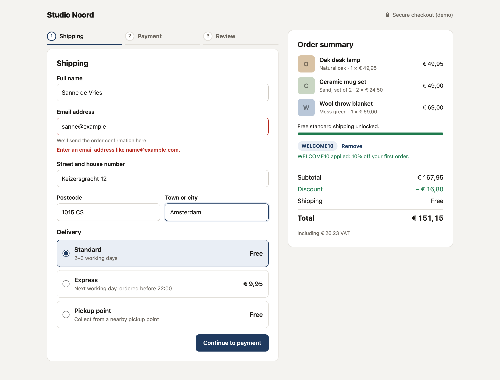
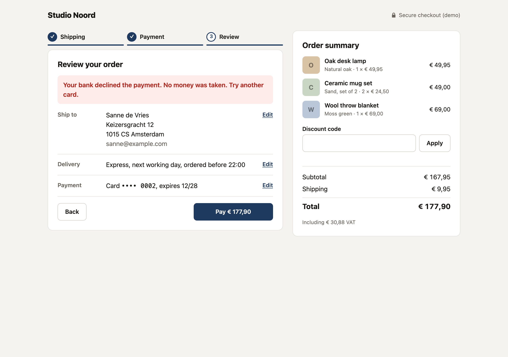
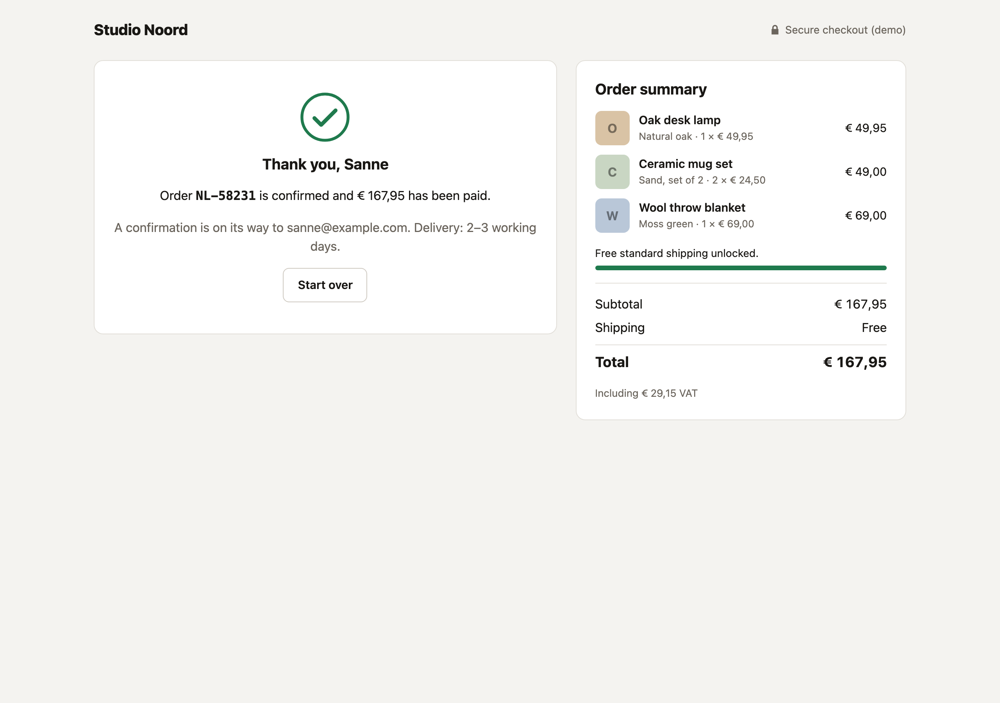

# Checkout Flow Demo

A three-step checkout (shipping, payment, review) for a small homeware shop. It focuses on the details that make a checkout feel trustworthy: inline validation that appears at the right moment, input formatting while you type, a live order summary with discount codes, a declined-payment path, and small animations that respect reduced-motion settings. Nothing is charged; a fake payment processor stands in for the provider.

**Live demo:** https://takeshisan19921.github.io/checkout-flow-demo/







## Try it

- Card `4242 4242 4242 4242` with any future expiry is accepted.
- Card `4000 0000 0000 0002` is always declined.
- Discount codes: `WELCOME10` (10% off) and `SAVE15` (€ 15 off orders over € 100).

## Business rules

- Prices include 21% VAT; the summary shows the VAT share the way Dutch receipts do.
- Standard and pickup delivery are free from € 75, judged on the subtotal **after** the discount. Express is always charged.
- Dutch postcodes are validated (four digits not starting with 0, two letters, never SA/SD/SS) and normalized to `1015 CS` when you leave the field.
- Card numbers pass a Luhn check. A card stays valid through the last day of its expiry month.

## Decisions worth explaining

- **Errors appear when they are useful.** A field is checked when you leave it, never before you have typed anything. Once a field shows an error, it re-checks on every keystroke so the message disappears as soon as the value is fixed.
- **Submitting moves focus to the first invalid field**, and each step change moves focus to the new step heading.
- **No double charges.** The pay button is guarded by a ref, so a fast double click can't start two payments before React re-renders.
- **A declined payment keeps everything.** The customer stays on the review step, sees why, and can edit the card without retyping the address.
- **Money is stored in cents**; totals, discounts and VAT are integer arithmetic in `src/lib/checkout.ts` with their own unit tests.

## Motion

Steps slide in, the step indicator fills, the total briefly highlights when it changes, the free shipping meter grows, a declined payment shakes the alert, and the confirmation draws its check mark. All of it is CSS, and `prefers-reduced-motion` turns it off.

## Tech

React 19, TypeScript (strict), Vite, Vitest and Testing Library. No form, UI or animation libraries.

## Run it

```sh
npm ci
npm run dev      # http://localhost:5173
npm test         # rules and UI tests
npm run build    # typecheck + production build
```

## Project structure

```
src/
  lib/          totals, coupons, validation, fake payment processor (+ unit tests)
  components/   ShippingStep, PaymentStep, ReviewStep, Confirmation, OrderSummary, Stepper, TextField
  App.tsx       step state and order placement (+ UI tests)
```

